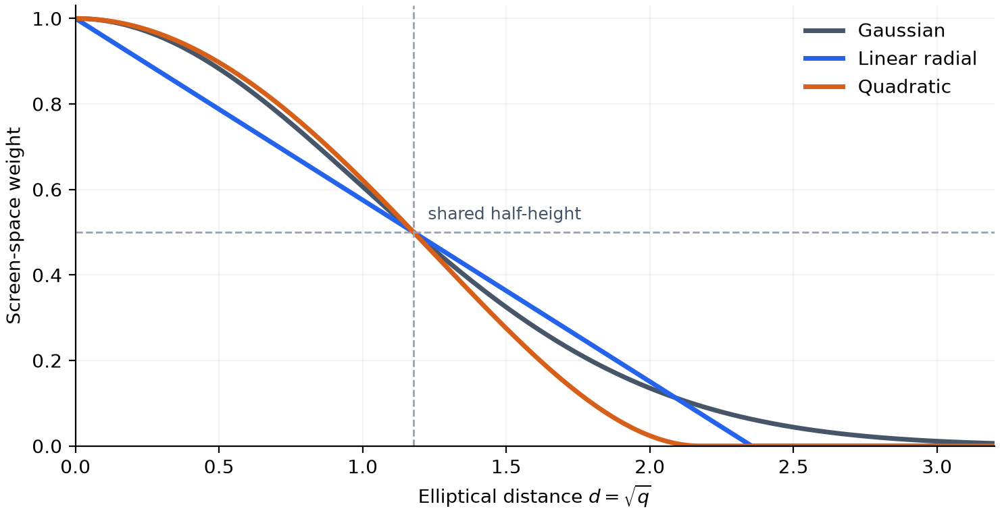
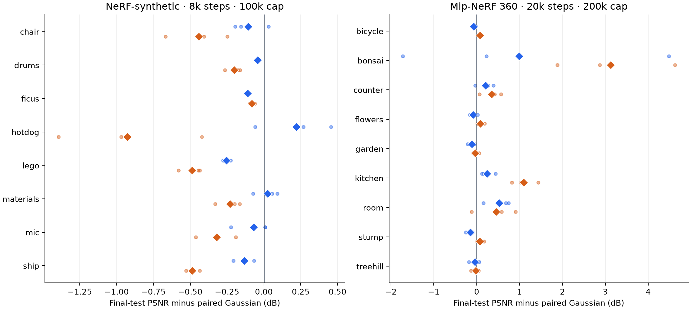
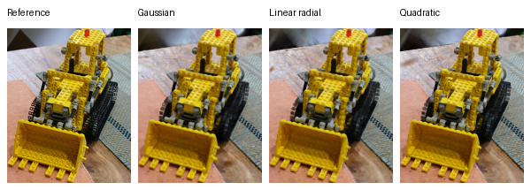
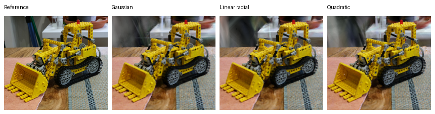
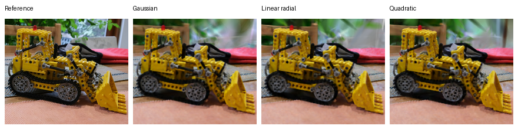
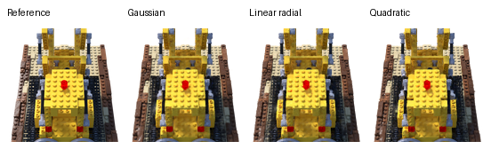
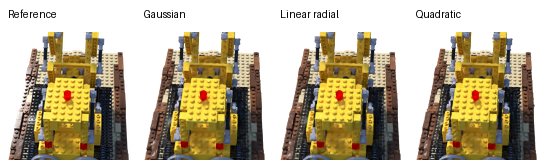
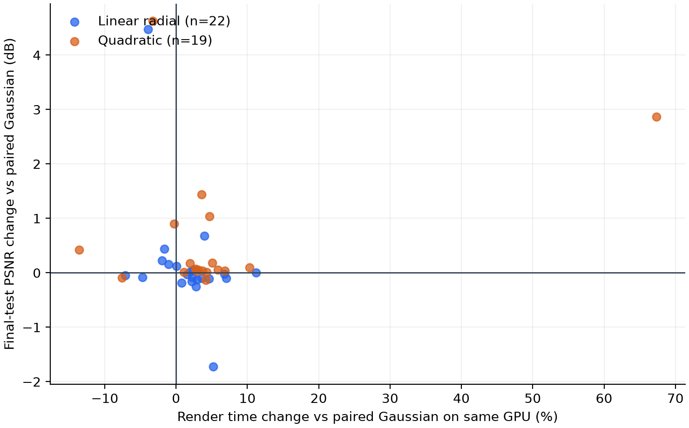

# Linear and quadratic screen-space kernels for 3D Gaussian splatting

**Draft status:** The numerical results and selected held-out test illustrations
below use saved final checkpoints. Add the course's required format and
authorship details before submission. The older bonsai illustration in the
Kernel Atlas uses a validation view and is labelled separately.

## Abstract

We compare Gaussian, linear radial, and quadratic (degree-2 polynomial)
screen-space weights in one splatting renderer. Within each experiment, the
projected 3D ellipsoids, color model, compositing, scene, and training budget
are held fixed; the pixel weight inside a projected footprint changes. We
evaluate eight NeRF-synthetic scenes at 256 × 256 pixels, a 100,000-splat cap,
and 8,000 steps, and nine Mip-NeRF 360 scenes at a 390-pixel long edge, a
200,000-splat cap, and 20,000 steps. Each scene has three paired seeds. At the
fixed final checkpoint, quadratic has worse PSNR, SSIM, and LPIPS than Gaussian
in every synthetic scene and seed. In the real-scene matrix it improves mean
PSNR in seven of nine scenes and 23 of 27 paired seeds. The mean scene gain is
+0.579 dB, but the median is +0.084 dB; bonsai and kitchen account for much
of the mean. Linear gives mixed results. The two matrices differ in several
settings, so their contrast does not isolate scene type. Kernel choice in this
renderer depends on scene and budget, and quality gains must be weighed against
rendering cost.

## 1. Introduction and related work

In 3D Gaussian splatting, projected ellipsoids contribute opacity to image
pixels before front-to-back compositing. The usual Gaussian footprint has a
soft tail. This project asks whether two fixed, finite-support screen-space
weights change reconstruction quality and cost when the rest of this renderer
is held constant within a scene. The study is a controlled comparison of this
implementation, not an attempt to reproduce a different splatting system.

| Work | Kernel or representation change | Relationship to this study |
| --- | --- | --- |
| Kerbl et al. (2023) [1] | Anisotropic 3D Gaussians, density control, and visibility-aware splatting | Establishes the Gaussian-splat baseline and broader pipeline. |
| Chen et al. (2024) [2] | 3D Linear Splatting replaces Gaussian kernels and reports sharper detail and faster rendering in its system. | Motivates linear weights; its full system and measurements are not controlled predictions for this renderer. |
| Huang et al. (2025) [3] | Deformable Radial Kernel Splatting uses learnable radial bases with additional primitive and rendering changes. | Shows the wider design space; this study fixes kernel shape and 3D primitives. |
| Mueller et al. (2026) [4] | A polynomial approximation to the exponential kernel aims to retain compatibility with Gaussian-optimized data and improve culling. | Motivates polynomial weights; our quadratic is a fixed half-height-matched kernel trained from scratch, not their approximation. |

The datasets come from the NeRF synthetic Blender collection [5] and Mip-NeRF
360 [6]. Published scores for those methods are not direct baselines here:
our images are resized, our validation split reserves training views in real
scenes, and our renderer and budgets differ.

## 2. Question and kernel definitions

The question is how the shape of a projected splat's screen-space weight affects held-out reconstruction quality, optimization behavior, and cost under a fixed within-scene budget. Let `q` be the squared Mahalanobis distance from a pixel to the center of the projected ellipse. The implemented weights are:

- Gaussian: `exp(-q/2)`.
- Linear radial: `max(0, 1 - sqrt(q / (8 ln 2)))`.
- Degree-2 polynomial: `max(0, 1 - q / R²)²`, where `R² = 2 ln 2 / (1 - 1/sqrt(2))`.

All three equal one-half at `q = 2 ln 2` (Figure 1). This matches the
half-maximum radius, not the integrated weight or total footprint area. Linear
and quadratic have finite natural support; Gaussian is truncated by the
implementation's alpha threshold and compact-box rule. The polynomial degree
is fixed at 2 and is not optimized. Kernel-specific support is used in
training, tile culling, validation, and test rendering. Full implementation
details are in [methodology.md](methodology.md).

*Figure 1. The implemented weights as functions of elliptical distance
`d = sqrt(q)`. The dashed lines mark the common half-height. This plot shows
the mathematical weights; practical renderer support also depends on opacity
and the compact-box threshold.*

## 3. Experimental design

| Matrix | Scenes | Image size | Capacity | Steps | Background | Projected-radius guard |
| --- | ---: | --- | ---: | ---: | --- | --- |
| NeRF-synthetic | 8 | 256 × 256 | 100,000 | 8,000 | White | Disabled |
| Mip-NeRF 360 | 9 | 390-pixel long edge | 200,000 | 20,000 | Black | 0.25 of larger image dimension |

Each scene has Gaussian, linear, and quadratic runs with seeds 7, 17, and 27.
Within a scene and matrix, the runs use the same configuration apart from
kernel and seed. Synthetic runs point to one generated `init.ply` and the same
train, validation, and test manifests per scene. Real runs use a common COLMAP
initialization and recorded camera split. The real-scene configuration also
omits a projected splat from a view if its support radius exceeds 25% of the
larger image dimension; the synthetic configuration has no such guard. These
choices are held fixed across kernels within each matrix.

The primary endpoint is each run's final checkpoint. We pair each alternative
with Gaussian at the same scene and seed and compare the mean over held-out
test views. Higher PSNR and SSIM and lower VGG LPIPS are better. We report seed
values and scene means; test views from one scene are repeated measurements,
not independent scene replicates. Reserved validation views diagnose training
but do not select the reported checkpoint. Render time is the median of five
end-to-end single-view renders after one warm-up; tile pairs count projected
splat/tile records. Elapsed cost is compared only for pairs run on the same
GPU model. Sampled peak GPU memory uses 250 ms NVML polling and may miss
shorter transients.

To estimate random-seed variability separately for each scene, we calculate
the **sample standard deviation** (`n−1` denominator) of the three Gaussian
final-test scores. We also calculate the sample SD of the three *paired*
alternative-minus-Gaussian differences per scene and kernel. The latter is
the relevant spread for judging a kernel effect because the runs share seeds.
We use two-sided 95% t intervals for the mean paired difference as a descriptive
uncertainty check; with only three selected seeds, these intervals are wide
and sensitive to outliers. A Gaussian SD is not itself a significance cutoff.

The real matrix has 81 of 81 expected final-test summaries and no missing-job
entries. Its generated reports check within-scene settings and splits, and
the nine saved COLMAP initialization PLYs in each real scene have the same
SHA-256 digest. The capacity diagnostic also checks initialization PLYs
across the two caps. The synthetic
matrix has 72 of 72 expected final-test summaries. Regenerated scene reports
found no settings warnings, but the original synthetic datasets are absent
locally, so their manifest contents and shared `init.ply` bytes could not be
checked. The saved synthetic run configs point to the same initialization path
within each scene. This is the verification boundary for the synthetic matrix.

## 4. Synthetic results: 8k steps, 100k splats

The table reports the mean of each scene's three paired seed differences from Gaussian. Positive PSNR and negative LPIPS favor the alternative.

| Scene | Linear ΔPSNR (dB) | Linear ΔLPIPS | Polynomial ΔPSNR (dB) | Polynomial ΔLPIPS |
| --- | ---: | ---: | ---: | ---: |
| Chair | −0.106 | +0.0029 | −0.441 | +0.0042 |
| Drums | −0.042 | +0.0024 | −0.201 | +0.0049 |
| Ficus | −0.111 | +0.0015 | −0.082 | +0.0035 |
| Hotdog | +0.221 | −0.0007 | −0.928 | +0.0102 |
| Lego | −0.255 | +0.0030 | −0.487 | +0.0030 |
| Materials | +0.024 | +0.0015 | −0.231 | +0.0096 |
| Mic | −0.069 | +0.0008 | −0.321 | +0.0033 |
| Ship | −0.133 | +0.0030 | −0.487 | +0.0072 |

Across scene means, linear changes PSNR by −0.059 dB and LPIPS by +0.0018;
it improves PSNR in two of eight scenes. Quadratic changes PSNR by −0.397 dB
and LPIPS by +0.0057. Its PSNR, SSIM, and LPIPS are worse than Gaussian in all
eight scenes and all 24 paired seeds. The negative result is consistent across
this matrix, including hotdog, where linear's mean PSNR improves while
quadratic's falls by 0.928 dB. It should remain visible alongside the real
findings.

## 5. Real-scene results: 20k steps, 200k splats

The table again reports the mean paired difference across the three seeds in
each scene. The complete source table is `reports/overview.csv` under the
real-scene output root.

| Scene | Linear ΔPSNR (dB) | Linear ΔLPIPS | Polynomial ΔPSNR (dB) | Polynomial ΔLPIPS |
| --- | ---: | ---: | ---: | ---: |
| Bicycle | −0.070 | +0.0054 | +0.076 | −0.0014 |
| Bonsai | +0.992 | −0.0093 | +3.123 | −0.0520 |
| Counter | +0.208 | −0.0005 | +0.350 | −0.0167 |
| Flowers | −0.086 | +0.0064 | +0.084 | −0.0029 |
| Garden | −0.116 | +0.0017 | −0.036 | +0.0001 |
| Kitchen | +0.238 | +0.0001 | +1.098 | −0.0278 |
| Room | +0.524 | +0.0005 | +0.455 | −0.0100 |
| Stump | −0.151 | +0.0070 | +0.074 | −0.0115 |
| Treehill | −0.042 | +0.0048 | −0.018 | −0.0019 |

Quadratic improves mean PSNR in seven of nine scenes (23/27 paired seeds),
mean SSIM in all nine, and mean LPIPS in eight. Its mean scene PSNR difference
is +0.579 dB, while its median scene difference is +0.084 dB. Bonsai
(+3.123 dB) and kitchen (+1.098 dB) drive much of the mean; garden and
treehill are near ties with slightly negative mean PSNR. Linear improves mean
PSNR in four scenes (13/27 seeds) and mean LPIPS in two scenes. Its mean scene
PSNR difference is +0.166 dB, but its median is −0.042 dB. These are
exploratory results from nine selected scenes and three seeds each, not
evidence of a universal ranking.

### Random-seed variability by scene

The Gaussian column estimates baseline PSNR variation between training seeds
for that scene. The other columns show the paired PSNR difference as mean ±
sample SD across the same three seeds, in dB. Full precision, SSIM, LPIPS,
and 95% paired intervals are in each matrix's `kernel_analysis/` CSV files.

| Matrix | Scene | Gaussian PSNR SD | Linear ΔPSNR mean ± SD | Quadratic ΔPSNR mean ± SD |
| --- | --- | ---: | ---: | ---: |
| Synthetic | Chair | 0.084 | −0.106 ± 0.121 | −0.441 ± 0.212 |
| Synthetic | Drums | 0.044 | −0.042 ± 0.011 | −0.201 ± 0.056 |
| Synthetic | Ficus | 0.023 | −0.111 ± 0.014 | −0.082 ± 0.019 |
| Synthetic | Hotdog | 0.208 | +0.221 ± 0.261 | −0.928 ± 0.488 |
| Synthetic | Lego | 0.071 | −0.255 ± 0.027 | −0.487 ± 0.080 |
| Synthetic | Materials | 0.079 | +0.024 ± 0.087 | −0.231 ± 0.088 |
| Synthetic | Mic | 0.122 | −0.069 ± 0.134 | −0.321 ± 0.136 |
| Synthetic | Ship | 0.074 | −0.133 ± 0.070 | −0.487 ± 0.048 |
| Real | Bicycle | 0.053 | −0.070 ± 0.047 | +0.076 ± 0.021 |
| Real | Bonsai | 1.415 | +0.992 ± 3.172 | +3.123 ± 1.389 |
| Real | Counter | 0.291 | +0.208 ± 0.216 | +0.350 ± 0.259 |
| Real | Flowers | 0.035 | −0.086 ± 0.096 | +0.084 ± 0.087 |
| Real | Garden | 0.114 | −0.116 ± 0.086 | −0.036 ± 0.079 |
| Real | Kitchen | 0.373 | +0.238 ± 0.173 | +1.098 ± 0.311 |
| Real | Room | 0.391 | +0.524 ± 0.322 | +0.455 ± 0.523 |
| Real | Stump | 0.060 | −0.151 ± 0.091 | +0.074 ± 0.086 |
| Real | Treehill | 0.104 | −0.042 ± 0.127 | −0.018 ± 0.100 |

The descriptive 95% paired PSNR interval excludes zero for quadratic gains
in **bicycle** (+0.025 to +0.127 dB) and **kitchen** (+0.325 to +1.870 dB)
in the real matrix. Bonsai's large mean gain has a wide interval
(−0.328 to +6.575 dB) because its Gaussian outcomes vary strongly by seed.
The other real-scene intervals include zero. In the synthetic matrix,
quadratic losses have intervals below zero for drums, ficus, lego, materials,
and ship; the three remaining scenes have intervals crossing zero. These are
unadjusted exploratory intervals across multiple scene and kernel comparisons,
not definitive significance claims.

*Figure 2. Each small dot is one seed's final-test PSNR difference from its
Gaussian partner; each diamond is the scene mean. Blue denotes linear radial,
orange denotes quadratic (`polynomial` in run files). Panels have different
x-axis scales. Synthetic and real-scene results should be read within their
own budgets.*

## 6. Selected held-out test views

Figures 3 and 4 compare the same crop of a reference test image with the three
final-checkpoint renders for seed 17. The frames were selected after inspecting
the saved results to illustrate gains, a loss, and a visually subtle synthetic
case. They are examples, not an unbiased sample of test views. The PSNR values
below come from the **full images**, not the displayed crops.

| Scene and test frame | Crop box in saved pixels | Linear ΔPSNR (dB) | Quadratic ΔPSNR (dB) |
| --- | --- | ---: | ---: |
| Kitchen `DSCF0744.JPG` | `(140, 15, 280, 190)` | +1.351 | +2.891 |
| Kitchen `DSCF0760.JPG` | `(95, 20, 300, 205)` | +0.802 | +1.706 |
| Kitchen `DSCF0656.JPG` | `(135, 20, 345, 200)` | −0.165 | −0.711 |
| Lego `./test/r_0` | `(64, 64, 192, 192)` | −0.110 | −0.222 |
| Lego `./test/r_1` | `(64, 64, 192, 192)` | −0.041 | −0.163 |

*Figure 3. Kitchen held-out test crops at 390 × 260 render resolution, seed 17.
Each comparison shows reference, Gaussian, linear radial, and quadratic, left to right.
The first two frames improve in full-view PSNR for both alternatives; the third
does not. In `DSCF0744`, the alternatives appear to show a small darker patch at the left
of the vehicle. The additional angles show that local appearance should be
read alongside the frame-specific metrics, rather than inferred from the
scene mean.*

*Figure 4. Lego held-out test crops at 256 × 256 render resolution, seed 17,
with the same left-to-right order. The kernel renders are difficult to
distinguish by eye in these two crops despite small negative full-view PSNR
differences for linear and quadratic. These views do not show the larger
synthetic-matrix losses on their own.*

## 7. Optimization and capacity diagnostics

All 81 real runs finish at the 200,000-splat cap. The largest gap between best and final validation PSNR is bonsai Gaussian seed 27: its best value occurs at step 8,500 and the 20,000-step value is 2.96 dB lower. Bonsai linear seed 17 is 1.14 dB below its best validation value at the final checkpoint. This makes the magnitude of the bonsai final-test advantage sensitive to optimization stability. The prespecified final checkpoint remains the primary endpoint; a different checkpoint rule would need to be specified before further test-based comparison.

Three matched 100k-versus-200k real-scene studies show that capacity response
is scene dependent. On bonsai, the polynomial-minus-Gaussian PSNR gap falls
from +5.18 to +3.12 dB. On counter, it falls from +0.67 to +0.35 dB. On
bicycle, it changes only from +0.04 to +0.08 dB. These figures come from the
three generated `capacity_report/<scene>/report.md` files under the
higher-capacity output root. The comparisons match training steps, schedule,
resolution, split, and initialization within each scene. They show that the
effect of increasing the splat cap is not uniform across scenes.

## 8. Rendering cost and quality

The real-scene reports compare elapsed cost only for kernel/Gaussian seed pairs
on the same GPU model. Linear's scene-level mean render-time changes range
from −5.9% to +4.8%; quadratic's range from −13.6% to +32.0%. Several scene
means use only one or two hardware-matched pairs. Across individual matched
pairs, Figure 5 shows 22 linear and 19 quadratic comparisons; the spread and
outliers do not establish a stable speed ranking. A quality gain can carry a
substantial render-time cost. Tile-pair counts measure rasterization work but
are not a substitute for elapsed time. Sampled peak training GPU memory is
unchanged between kernel choices in matched real-scene pairs at the 250 ms
sampling resolution; this does not exclude short-lived differences.

*Figure 5. Each point compares an alternative with the Gaussian run for the
same real scene and seed, only when the GPU model matches. Positive vertical
values favor the alternative; negative horizontal values mean faster rendering.
This is an exploratory quality-cost view, not a cross-hardware benchmark.*

## 9. Interpretation and limitations

The synthetic and real matrices change several settings together: scene set
and type, image resolution, background, initialization, splat cap, training
duration, learning-rate schedule, and projected-radius guard. Their differing
outcomes cannot identify which of these caused the contrast. The capacity
diagnostic holds more settings fixed, but covers only three real scenes and
does not explain the synthetic-to-real difference. The large bonsai gain is
also affected by late Gaussian validation decline. The fixed final checkpoint
remains the primary endpoint; selecting another checkpoint after inspecting
test results would change the protocol.

The kitchen and Lego crops in Figures 3 and 4 are held-out test views, but
they were chosen after reading per-view results and cover only one seed in two
scenes. Their visible details cannot establish a general artifact or sharpness
ranking. The older bonsai DSCF5648 images in the
[Kernel Atlas](../site/analysis.html) are **validation-view illustrations**.
Test-view counts within a scene do not increase the number of independent
scenes. Three seeds provide limited information about optimization variability,
and timing differences are hardware sensitive.

The supported conclusion is configuration specific: quadratic performs worse
throughout the tested synthetic matrix and often better in the 200k real
matrix; linear is inconsistent. Neither result implies that a kernel is best
for 3DGS in general.

## 10. Reproducibility and conclusion

The [README](../README.md) gives commands to train the nine kernel/seed jobs
per scene and regenerate each matrix's `kernel_analysis/` and `reports/`
directories. The report's tables use `reports/overview.csv`; the paired-seed
PSNR figure uses each run's `test_summary.json`; the quality-cost figure also
uses its GPU model and mean render time. The capacity figures come from
`scripts/report_capacity.py`. The test illustrations use
`scripts/slurm_export_test_crops.sh` with the frame names and crop boxes in
Section 6; the five comparison images are included in `docs/figures/`.
Generated results and source datasets are Git-ignored, so a fresh clone needs
the saved run trees to regenerate these exact tables. Re-running training
requires the source datasets, synthetic
initializations, CUDA environment, and settings in the checked-in configs;
`requirements.txt` is not a version lockfile.

These experiments answer a narrower question than the prior systems: changing
only the fixed screen-space weight in this trainer can matter substantially,
but its direction and cost depend on the scene and training budget. The
synthetic negative result, real-scene heterogeneity, and matched capacity
diagnostic should all be reported together.

## References

1. Kerbl, B., Kopanas, G., Leimkühler, T., and Drettakis, G. (2023).
   [3D Gaussian Splatting for Real-Time Radiance Field Rendering](https://arxiv.org/abs/2308.04079).
2. Chen, H., et al. (2024).
   [Beyond Gaussians: Fast and High-Fidelity 3D Splatting with Linear Kernels](https://arxiv.org/abs/2411.12440).
3. Huang, Y.-H., et al. (2025).
   [Deformable Radial Kernel Splatting](https://openaccess.thecvf.com/content/CVPR2025/papers/Huang_Deformable_Radial_Kernel_Splatting_CVPR_2025_paper.pdf).
4. Mueller, J. H., Winter, M., and Steinberger, M. (2026).
   [From ex(p) to poly: Gaussian Splatting with Polynomial Kernels](https://arxiv.org/abs/2603.18707).
5. Mildenhall, B., et al. (2020).
   [NeRF: Representing Scenes as Neural Radiance Fields for View Synthesis](https://arxiv.org/abs/2003.08934).
6. Barron, J. T., et al. (2022).
   [Mip-NeRF 360: Unbounded Anti-Aliased Neural Radiance Fields](https://openaccess.thecvf.com/content/CVPR2022/html/Barron_Mip-NeRF_360_Unbounded_Anti-Aliased_Neural_Radiance_Fields_CVPR_2022_paper.html).
